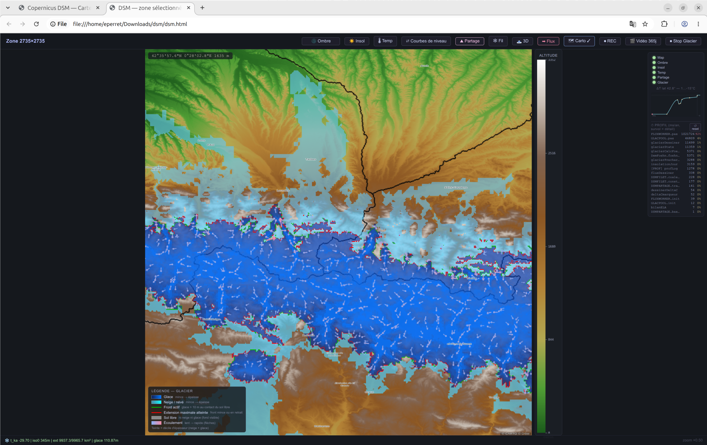
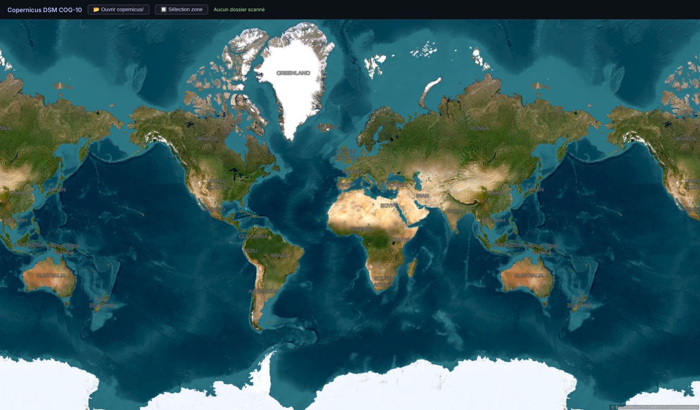
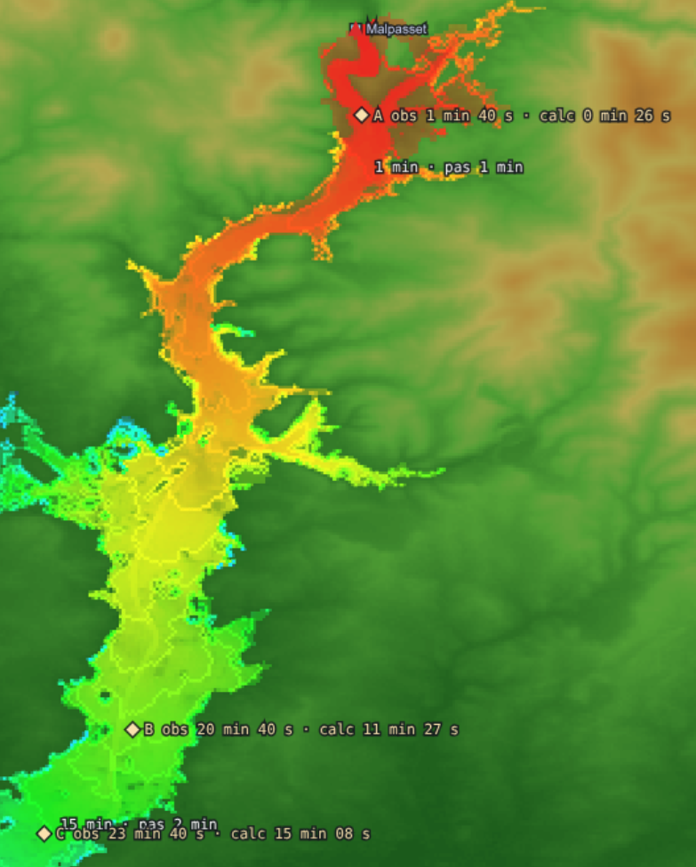

<!-- ═══════════════════════════════════════════════════════════════════
     FILE    : README.md - v17/10/2026
     PURPOSE : project overview for GitHub
     AUTHOR  : Eric P.
     REVIEW  : Opus 5.5
     LICENSE : CC BY-NC 4.0 — source to cite: https://github.com/ericperret/crest/
               commercial use forbidden without the author's written consent (see LICENSE)
     ═══════════════════════════════════════════════════════════════════ -->

# crest — relief, shadows and palaeoglaciers in the browser

🇫🇷 [Version française : LISEZMOI.md](LISEZMOI.md)

▶️ **[Launch crest (tile map)](https://ericperret.github.io/crest/map.html)** — the `dsm.html` viewer opens from the map, on Copernicus tiles stored on your computer.

Repository: <https://github.com/ericperret/crest/>

User interface in French.



Digital elevation model viewer (Copernicus GLO-30) and glacier simulator
over the last climate cycle (−30,000 years → today).

HTML, CSS and JavaScript only: **no library, no server, no installation**.
Open `map.html` in a recent browser, that is all. The only network accesses
are the base maps (Esri and Carto tiles).

---

## What the tool does

**Tile map (`map.html`)**



- World grid of the 1°×1° Copernicus tiles; tiles present in the local
  folder are shown in green.
- Ready-to-copy AWS S3 command to download the missing tiles.
- Click on a tile: opens it in the viewer.
- Selection of a rectangular area spanning several tiles: mosaic assembled,
  made square and sent to the viewer.

**Viewer (`dsm.html`)**

| Button | Function |
|---|---|
| ⇄ Courbes de niveau | Equalised hypsometry or contour lines |
| 🌑 Ombre | Horizons over 64 azimuths, cast shadows hour by hour |
| ☀️ Insol | Annual direct insolation, including horizon and the orbit of the epoch |
| 🌡 Temp | Mean annual temperature (palaeo anomaly + lapse rate) |
| ⛰ Partage | Drainage divides between the four edges |
| 🕸 Fil / 🗻 3D | Adaptive facet mesh, 3D wireframe view |
| ❄️ Glacier | Full glacier simulation (see below) |
| ➡ Flux | Ice-flow arrows |
| 🗺 Carto | Geographic labels overlay |
| 🎬 Vidéo 365j | AVI film of the shadows at sunrise, one day per frame |
| ⏺ REC | WebM screen recording |

Control panel: **year** (−20,000 to 2100), **day**, **solar time**.
Keyboard: ↑↓ selects the slider, ←→ changes the value.

Status lights, temperature anomaly curve of the epoch, built-in profiler and
cartographic legend of the glacier (ice, firn, fronts).

---

## Getting started

1. Download one or more Copernicus GLO-30 tiles. The command is given by
   `map.html` (☁️ button or click on a missing tile), for example:
   ```
   aws s3 sync s3://copernicus-dem-30m/Copernicus_DSM_COG_10_N45_00_E006_00_DEM/ \
       ./Copernicus_DSM_COG_10_N45_00_E006_00_DEM/ \
       --no-sign-request --exclude "*" --include "*_DEM.tif"
   ```
   No AWS account is needed (public data).
2. Open `map.html`, button **📂 Ouvrir copernicus/** (open folder), choose the folder.
3. Click a green tile, or **🔲 Sélection zone** (select area) then **✔ Charger la
   zone** (load area). The viewer opens in a new tab (allow pop-ups for this file).
4. In `dsm.html`: **🌑 Ombre** first (computes the horizons, required by
   Insol, Temp and Glacier), then the other functions.

Browser: recent Chrome, Edge or Firefox (Workers, OffscreenCanvas,
DecompressionStream, BroadcastChannel).

---

## The glacier simulation

At start-up: 10 years frozen at −30 ka, then a 5-day step up to 2026
(1 simulated year = 1/1000 ka of forcing).

| Step | Module | Model |
|---|---|---|
| Orbit | `dsm-astro.js` | Laskar 2004, equation of centre from Berger 1978 |
| Temperature | `dsm-temp.js` | North/south borehole anomaly weighted by latitude, 6.5 °C/km, seasonal and diurnal cycle |
| Precipitation, foehn | `dsm-foehn.js` | Smith & Barstad 2004 by altitude bands (FFT), thermodynamic foehn |
| Sunshine | `dsm-insol.js` | Direct radiation, horizons, 73 maps per year |
| Mesh | `dsm-filet.js` | Adaptive quadtree, facets with bounded normal cone |
| Mass balance | `dsm-worker-glacier.js` | Closed-form degree-hours, snow → ice by compaction |
| Basal sliding | `dsm-basal.js` | Bed temperature, frozen / temperate / surge regimes |
| Flow | `dsm-flux.js` | Implicit SIA (Glen n = 3), Picard, preconditioned conjugate gradient |
| Parallelism | `dsm-worker-flux.js` | One Worker per drainage basin (4 independent basins) |

Watchdog: if a step takes more than 15 s, the status bar and the console
show the step, the time step and the solver state.

---

## Right-click: tap, lava, dam break

Known dams in the area (CFBR, then Global Dam Watch, then FAO AQUASTAT,
without duplicates) are placed on the map at load time (cyan square, name
written when 40 markers or fewer are visible, hover: name, height, volume).
Right-click opens a menu; on a marker, the first entry directly starts the
failure of that dam.

- **Tap** (Robinet): gentle filling from the clicked point (successive
  basins, only the most downstream basin rises), until the sea, the map edge
  or a closed depression. Also serves as the reference path for the dam break.
- **Lava** (Lave, see below): eruption chosen from a list of
  known cases, vent at the clicked point, at the documented vent or entered
  in WGS84 (« 37.750° N, 15.005° E »).
- **Dam break** (Rupture de barrage): offers the known dams within 30 km
  (CFBR first, then Global Dam Watch, then FAO AQUASTAT), or entry of the
  volume (km³) and water height (m) at the clicked point. Worst case: full
  reservoir, instantaneous and total failure, bare ground, dry downstream bed.
  Only the downstream side is modelled: the worst case is a convention
  (physically impossible) meant to give populations early arrival times,
  hence with a margin.

| Step | Model |
|---|---|
| Dam | Toe found on the tap path: downstream face detected in the DSM (slope > 1/5, USBR 1987), full reservoir = toe + height; destroyed dam (absent from the DSM): toe at the record's marker |
| Breach | Total and instantaneous, across the whole valley width below the reservoir level at the dam toe (or along the known dike length); watertight dike line elsewhere |
| Reservoir | Level-pool reservoir (Fread 1988) of volume V and height h0; level imposed at the breach, outflow computed by the scheme (critical flow from the opening, worst case); the upstream basin is outside the domain (walls), the downstream wave can neither invade it nor spread over the lake surface of the DSM |
| Wave | 2D shallow water (Saint-Venant): depth h and velocity (u, v) at each pixel at each instant; conservative staggered scheme of Stelling & Duinmeijer (2003), transverse transport in the same form (Kramer & Stelling 2008); inertia carries the water straight on in bends, the bank slows it (rise ≤ V²/2g), nothing else is imposed |
| Friction | Bed: Manning (1891), n = 0.020 s·m⁻¹ᐟ³ (bare ground), semi-implicit per face (slows without reversing the velocity, stable in thin layers); water on water: Smagorinsky eddy viscosity (1963), Cs = 0.17 (Lilly 1967) |
| Solid load | Takahashi (2007), 2D formulation of Kanako (Nakatani et al. 2008): grains carried with the water, erosion and deposition towards an equilibrium concentration depending on the surface slope (stony debris flow, immature debris flow, bed load), δe = 0.0007, δd = 0.05, d = 10 cm, C* = 0.6, tanφ = 0.7; debris-flow resistance in d²/h³, never lower than clear water: it slows the front and edges in thin layers, thick layers stay in Manning; gullying not handled (relief and depth unchanged, only the composition evolves); grain mass conserved (taken = deposited + exited + in transport) |
| Boundaries | Sea (z ≤ 0.5 m) and map edges: water leaves the domain; no data: wall |
| Timing | Front arrival per pixel (depth ≥ 10 cm) at each computation step (CFL 0.5) |
| Isochrones | 1 min step, lengthened (2, 5, 10… 120 min) as soon as two successive fronts are less than 10 pixels apart; front = reached pixel farthest from the toe |
| End | No new pixel reached for 1 h (48 h at most) |
| Validation | `BARRAGE_FABRIQUE().essaiRitter()`: Ritter solution (1892), frictionless; depth at the dam within 1 %, mass conserved to 10⁻¹⁵, 10 cm front 10 to 14 % late (first-order numerical diffusion); real case: Malpasset 1959 (below) |

**Live display**: during the computation, the footprint is drawn as
simulated time runs (colour = arrival time, red early → purple late; strong
opacity while water is present, increasing with depth from 0.1 to 10 m;
weak opacity after recession). Status bar: time, front, breach discharge,
remaining share of the reservoir.

**Replay** (computation finished): play / pause, time slider, speed
1 min/s to 1 h/s; isochrones appear progressively. Depths interpolated
between one-minute snapshots (step doubled if the snapshot memory exceeds
6·10⁷ depths).

**Malpasset test case (Fréjus, 2 December 1959)**

CFBR record marked "destroyed": V = 0.055 km³ (CADAM benchmark), h = 60 m
(reservoir at elevation 100 m), start at the marker. Three measurement
points are placed on the map (yellow diamonds): EDF transformers A, B and C
whose shutdown dated the passage of the wave. Benchmark coordinates
(BASEMENT v3, table 5) converted from the local frame to WGS84: origin in
the middle of the dam line, 5° rotation fitted on the Reyran bed, ±200 m.
At the end of the computation, the arrival time is read at the point
(nearest reached pixel within 200 m otherwise) and compared with the
observed time: status bar, console (`console.table`), diamond label.



| Point | Distance | Observed | EDF time | Computed (n = 0.020, clear water) | Difference |
|---|---|---|---|---|---|
| A | 0.9 km | 1 min 40 s | 21:13 | 26 s | −74 % |
| B | 7.3 km | 20 min 40 s | 21:34 (entrance of Fréjus) | 11 min 27 s | −45 % |
| C | 8.5 km | 23 min 40 s | ≈ 21:35 (northern HV yard of Fréjus) | 15 min 08 s | −36 % |

The model is early everywhere, which is the intended direction. The lead
builds up between A and B: from B to C, in the plain, the computation takes
3 min 41 s against 3 min observed. Retained causes: the DSM is today's
(valley gullied by the 1959 wave, steeper and smoother in its first
kilometre, A8 motorway platform), whereas the reference models start from
the 1931 IGN map; bare-ground friction (0.020 against 0.033 in the
references); clear water. At the start, 880 m in 26 s (≈ 34 m/s), of the
order of the Ritter celerity 2√(g·h0) ≈ 48 m/s.

**⬇ Shapefile export**: ZIP (.shp .shx .dbf .prj .cpg), geographic WGS84
(EPSG:4326), one polygon feature per arrival band (isochrones, then, once
the front has stopped, lateral filling at the step of the last isochrone),
exact pixel outlines without simplification.

| Field | Content |
|---|---|
| T_DEB_MIN, T_FIN_MIN | The front reaches the band between these two times (min after failure) |
| T_FIN_HM | T_FIN as hh:mm |
| PAS_MIN | Isochrone step of the band |
| SURF_HA, NB_PIX | Area (WGS84 authalic sphere), number of pixels |
| H_MAX_M, V_MAX_MS | Maximum depth and velocity reached in the band |
| BARRAGE, V_KM3, H0_M, Q_MAX_M3S | Scenario: dam, volume, height, peak breach discharge |

Hover: arrival time, depth at the displayed instant, maximum depth,
velocity and grain concentration. Status bar at the end: volumes of grains
taken and deposited. Durations written "45 min" under one hour, "1 h 10"
beyond. Space or ✕: clear.

---

## Right-click: lava flow

The dialog offers known eruptions; each line gives the lava, the discharge,
the volume, the duration and a sentence guiding the choice (source on hover).
The vent is the clicked point, or the position entered in WGS84
(EPSG:4326), or the documented vent when the record has one (📍). Worst
case, as for dams: published peak discharge held until the published volume
is exhausted.

| Eruption | Lava | Discharge | Volume | Duration |
|---|---|---|---|---|
| Nyiragongo 2002 | ultra-fluid foidite | 460 m³/s | 20 Mm³ | 12 h |
| Villarrica 1971 | basaltic andesite | 800 m³/s | 23 Mm³ | 8 h |
| Piton de la Fournaise 2007 | hotspot basalt | 200 m³/s | 140 Mm³ | 8 d |
| La Palma 2021 | basanite | 42.7 m³/s | 212 Mm³ | 57 d |
| Etna 2004-2005 (test case) | Etna basalt | 4 m³/s | 46 Mm³ | 133 d |
| Lonquimay 1988-1990 | andesite | 80 m³/s | 230 Mm³ | 33 d |

| Step | Model |
|---|---|
| Flow | Bingham thin film (lubrication, inertia neglected): q = ρgS·Y²(3h − Y)/(6μ), Y = h − τy/(ρgS), zero below the yield (Liu & Mei 1989; Balmforth et al. 2000) |
| Viscosity | GRD melt (Giordano, Russell & Dingwell 2008) computed from the composition, × Einstein-Roscoe (1 − 1.51φ)^−2.5; crystals φ = 0.15 at the vent, + 0.45 until solidification (FLOWGO) |
| Yield strength | 0.01(e^0.08(Te − T) − 1) + 6500φ^2.85 Pa (Dragoni 1989; Ryerson et al. 1988) |
| Cooling | FLOWGO (Harris & Rowland 2001; PyFLOWGO, Chevrel et al. 2018) pixel by pixel: radiation of a 500 °C crust and of cracks at T − 140 K, forced convection (5 m/s wind), conduction into the ground; sensible and latent inertia (350 kJ/kg) |
| Solidification | Below 900 °C the solidified lava becomes relief (MAGFLOW, Vicari et al. 2007) |
| Scheme | Implicit in level (backward Euler, two Picard passes, preconditioned conjugate gradient), computation box following the flow; heat carried by the fluxes; adaptive step ≤ 2 min |
| Validation | `BARRAGE_FABRIQUE().essaiHuppert()`: viscous spreading of Huppert (1982), radius +3.5 % (less than one pixel), mass conserved; Etna 2004-2005 on the Copernicus relief, published parameters without tuning, vent at 2,600 m (bottom of the fissure, worst case): front at 1,656 m elevation at the end of the eruption, against a visual marker around 1,980 m; elevation drop covered 944 m against ≈ 620 m, i.e. +53 %, early as the worst case requires (MAGFLOW alone: stops at 0.49 km) |

Display, replay, isochrones (step lengthened up to 24 h) and Shapefile
export are those of the dam-break wave; hovering gives the final thickness
(fluid and solidified) and the maximum velocity. Durations beyond two days
written "3 j 05 h".

---

## Files

```
map.html               tile map, area assembly
dsm.html               viewer and glacier loop
dsm-carte.js           native Web Mercator tiled map (replaces Leaflet)
dsm-worker-tiff.js     GeoTIFF reading (Worker), hypsometry, contours
dsm-astro.js           palaeo orbit, sunrise/sunset, Sun position
dsm-ombre.js           horizons, shadows, shadow film
dsm-insol.js           direct insolation (Worker pool)
dsm-temp.js            surface climate
dsm-partage.js         drainage divides (priority-flood)
dsm-mesh.js            regular mesh and facets (statistics)
dsm-filet.js           adaptive glacier mesh
dsm-fil3d.js           3D view of the mesh
dsm-foehn.js           orographic precipitation and foehn
dsm-worker-glacier.js  mass balance (Worker pool)
dsm-basal.js           basal sliding
dsm-flux.js            ice flow
dsm-worker-flux.js     parallel flow per basin
dsm-barrage.js         right-click menu, choice of dam or eruption, drawing
dsm-worker-barrage.js  dam-break wave and lava flow (Worker), isochrones
dsm-export-shp.js      Shapefile export of the dated footprint
dsm-barrages-cfbr.js   large French dams (CFBR), Malpasset test case
dsm-barrages-gdw.js    world dams (Global Dam Watch v1.0)
dsm-barrages-fao.js    additional world dams (FAO AQUASTAT)
dsm-laves.js           known eruptions, GRD viscosity, WGS84 entry
malpasset-essai.png    screenshot of the Malpasset test case
screenshot_dsm.png     screenshot of the viewer
screenshot_map.png     screenshot of the tile map
```

All files go in the same folder. Each source carries a header block and
each function a comment input → processing → output with an "ALGO" line.

---

## Known limitations

- "Tap" simulation (right-click): single-direction flow (D8), one outlet
  per sill; passage under an obstacle if the surface exceeds the ground at
  2 px (bridges, jams… but also thin ridges).
- Dam break: solid load with a single grain size (d = 10 cm), without
  gullying or bulking of the flow; uniform bed friction (Manning 0.020, bare
  ground), without land cover; a water body in the DSM is treated as ground
  (no bathymetry); present-day relief (a destroyed dam is simulated on the
  valley modified by its failure); level-pool reservoir (critical discharge
  from the opening, worst case); numerical front on a dry bed 10 to 14 %
  behind Ritter; a single Worker (file:// opening, no shared memory),
  computation time proportional to the wet pixels.
- Lava flow: a single point vent (no fissure); no lava tubes (the crust
  always radiates); generic composition, crystals and crust per lava type;
  degassed melt; constant discharge; long computation for eruptions lasting
  several months (Etna 2004: about 25 min).
- Ice does not cross drainage divides (independent basins).
- Direct radiation only, without diffuse or reflected radiation.
- No contour lines below 1000 m.
- Basal sliding and the "postman" of the flow: project-specific
  assumptions, not calibrated.
- Doubtful passages are marked "⚠" in the code comments.

---

## To do

- Dam break — replay Malpasset with the solid load.
- Dam break — validation on the 90° bend test of Soares-Frazão & Zech
  (2002, J. Hydraul. Eng. 128(11)).
- Lava — fissures (several vents), lava tubes, discharge curve; volcanoes
  placed on the map.

---

## Base maps and Carto key

Labels use Carto with a `CARTO_KEY` declared in `dsm.html` and `map.html`.
Empty key: automatic switch to Esri labels. Free key:
<https://carto.com/basemaps/>.

## Data and attributions

- Copernicus DEM GLO-30: © DLR e.V. 2010-2014 and © Airbus Defence and
  Space GmbH 2014-2018, provided under COPERNICUS by the European Union
  and ESA.
- Imagery: © Esri, Maxar. Labels: © CARTO, © OpenStreetMap.
- World dams: Global Dam Watch v1.0, © European Union 1995-2026,
  CC BY 4.0 — Lehner B. et al. (2024), Scientific Data 11:1069; only dams
  with known height and volume extracted.
- Large French dams: French Committee on Dams and Reservoirs (CFBR).
- Additional dams: FAO. 2021. AQUASTAT: Geo-referenced Database on Dams.
  Accessed 27 September 2026.
  <https://www.fao.org/aquastat/en/databases/dams> licence CC-BY-4.0;
  regional files merged, dams with known height and volume.

## License

[CC BY-NC 4.0](https://creativecommons.org/licenses/by-nc/4.0/) —
free non-commercial use provided the source is cited:

> crest — Eric P. — <https://github.com/ericperret/crest/>

Commercial use forbidden without the author's written consent.
Details in [`LICENSE`](LICENSE).

## Author

Eric P. — review: Opus 5.5.
